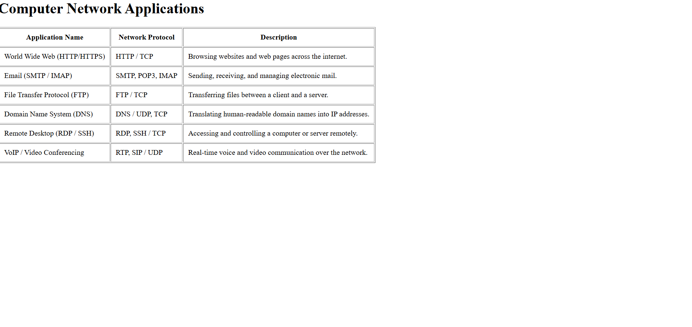

# EX01 Developing a Simple Webserver

## AIM:
To develop a simple webserver to serve html pages.

## DESIGN STEPS:
### Step 1:
Create a Python program using the http.server module.

### Step 2:
Write the HTML content for the table of computer network applications.

### Step 3:
Define a request handler class with a do_GET method that sends the HTML page.

### Step 4:
Run the server and open it in the browser to view the output.

## PROGRAM:
```

from http.server import HTTPServer, BaseHTTPRequestHandler

content = """
<h1>Computer Network Applications</h1>

<table border="1" cellpadding="10">
<tr>
<th>Application Name</th>
<th>Network Protocol</th>
<th>Description</th>
</tr>
<tr>
<td>World Wide Web (HTTP/HTTPS)</td>
<td>HTTP / TCP</td>
<td>Browsing websites and web pages across the internet.</td>
</tr>
<tr>
<td>Email (SMTP / IMAP)</td>
<td>SMTP, POP3, IMAP</td>
<td>Sending, receiving, and managing electronic mail.</td>
</tr>
<tr>
<td>File Transfer Protocol (FTP)</td>
<td>FTP / TCP</td>
<td>Transferring files between a client and a server.</td>
</tr>
<tr>
<td>Domain Name System (DNS)</td>
<td>DNS / UDP, TCP</td>
<td>Translating human-readable domain names into IP addresses.</td>
</tr>
<tr>
<td>Remote Desktop (RDP / SSH)</td>
<td>RDP, SSH / TCP</td>
<td>Accessing and controlling a computer or server remotely.</td>
</tr>
<tr>
<td>VoIP / Video Conferencing</td>
<td>RTP, SIP / UDP</td>
<td>Real-time voice and video communication over the network.</td>
</tr>
</table>
"""

class MyHandler(BaseHTTPRequestHandler):
    def do_GET(self):
        self.send_response(200)
        self.send_header("Content-type", "text/html")
        self.end_headers()
        self.wfile.write(content.encode())

server_address = ("", 8080)
httpd = HTTPServer(server_address, MyHandler)

print("My Webserver is running...")
httpd.serve_forever()

```

## OUTPUT:



## RESULT:
The program for implementing simple webserver is executed successfully.